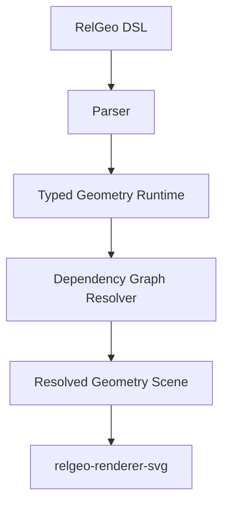

# RelGeo Core

Core engine untuk RelGeo: sebuah **relation-first geometry runtime** untuk gambar vektor deklaratif yang ditulis sebagai source.

Kontrak bahasa yang dirujuk package ini adalah `RelGeo DSL v0.5`, yang disajikan melalui website pada `/docs/language-spec/`.

Metadata package `relgeo-core` saat ini adalah `0.4.0`. Versi package ini terpisah dari versi kontrak DSL `v0.5` dan tidak menyatakan bahwa package telah dipublish sebagai release publik.

Status packaging saat ini:

* package ini adalah library surface utama untuk runtime RelGeo
* jalur konsumsi yang paling sehat saat ini masih melalui monorepo workspace
* surface registry mandiri sebaiknya diperlakukan sebagai langkah packaging terpisah

Pakai package ini jika Anda ingin:

* mem-parse dan me-resolve dokumen RelGeo di kode Anda sendiri
* mengambil query geometry, values, dependency graph, atau resolved scene
* membangun renderer, CLI, atau tooling lain di atas runtime utama

Jika yang Anda butuhkan berbeda:

* gunakan `relgeo-language-service` untuk completion dan diagnostics editor
* gunakan `relgeo-renderer-svg` untuk output SVG
* gunakan `relgeo-cli` untuk workflow terminal tanpa integrasi library langsung

`relgeo-core` bertanggung jawab untuk:

* parsing DSL RelGeo
* dependency-ordered evaluation
* semantic geometry resolution
* geometric querying
* validation & diagnostics
* coordinate space management
* resolved scene generation

RelGeo Core bukan sekadar parser YAML atau helper SVG.

Ia diposisikan sebagai:

> typed geometry runtime untuk authoring gambar berbasis relasi yang deterministik dan reusable.

---

# Philosophy

RelGeo dibangun dengan asumsi bahwa:

```txt
koordinat absolut adalah hasil akhir,
bukan sumber utama intent desain
```

Karena itu, RelGeo mendorong konstruksi seperti:

```yaml
rumah:
  type: rect
  place:
    centerX: tanah.centerX
    bottom: tanah.bottom
```

bukan:

```yaml
x: 120
y: 40
```

Dengan pendekatan ini:

* intent desain tetap eksplisit
* relasi ukuran tetap terbaca
* parameter tetap terhubung
* hasil LLM tetap editable
* geometri tetap reproducible
* satu aturan gambar dapat dipakai ulang untuk input berbeda

---

# Positioning

RelGeo Core diposisikan sebagai:

* typed geometry runtime
* deterministic construction engine
* semantic drawing system
* completion-oriented relation-first geometry engine

Bukan:

* CAD boolean engine penuh
* general equation solver
* mesh modeling engine
* direct manipulation editor

---

# Architecture



---

# Core Principles

## Relation-First

Geometri dibangun menggunakan relasi antar objek:

* placement
* anchors
* tangent
* intersection
* offset
* split
* geometric query

---

## Strict Determinism

Untuk input dan parameter yang sama:

```txt
hasil geometry harus selalu identik
```

Resolver tidak diperbolehkan:

* melakukan auto-fixing diam-diam
* mengubah geometri implisit
* menghasilkan solusi nondeterministic

---

## No General Constraint Solver

RelGeo sengaja tidak menggunakan arbitrary equation solver.

Seluruh evaluasi dilakukan melalui:

```txt
Dependency Graph
```

Hal ini menjaga:

* performa
* reproducibility
* predictability
* incremental-runtime readiness

---

## Typed Geometry Runtime

Primitive diperlakukan sebagai entitas semantik nyata.

Contoh:

```txt
line memiliki start/end/length
circle memiliki center/radius
path memiliki segment/area/length
```

Bukan sekadar JSON mentah.

---

# Features

## Primitive Geometry

Primitive dan operation aktif yang saat ini penting di surface v0.5 mencakup:

* line, rect, circle, ellipse
* arc, quadratic, cubic, path, polygon
* boolean
* reverse, translate, rotate, scale, mirror
* split untuk memecah open path-like target di titik eksplisit

Primitive yang saat ini didukung:

* `point`
* `line`
* `rect`
* `circle`
* `arc`
* `quadratic`
* `cubic`
* `path`
* `polygon`
* `text`
* `group`
* `clone`

---

## Advanced Path System

`path` pada surface aktif saat ini mendukung:

* segmented path
* line segments
* arc segments
* quadratic bezier
* cubic bezier
* closed path
* holes
* fillet
* chamfer
* offset
* tangent queries
* geometric intersection

Contoh:

```yaml
outline:
  type: path
  segments:
    - line:
        from: A
        to: B

    - arc:
        through: C
        to: D

    - cubic:
        cp1: E
        cp2: F
        to: G

  closed: true
```

---

## Geometry Query System

RelGeo Core menyediakan sistem query geometri dinamis:

```txt
intersection(...)
pointAt(...)
tangentAt(...)
normalAt(...)
closestPoint(...)
length(...)
area(...)
toWorld(...)
toLocal(...)
```

Contoh:

```yaml
P:
  type: point
  at: pointAt(outline, 0.35)
```

---

## Deterministic Intersection Engine

Intersection engine mendukung:

* line-line
* line-circle
* line-arc
* line-path
* circle-circle
* arc-arc
* path-path

Jika intersection menghasilkan banyak titik:

```txt
MULTIPLE_INTERSECTIONS
```

akan dikeluarkan kecuali selector eksplisit diberikan.

Contoh:

```yaml
P:
  type: point
  at: intersection(circle1, line1, nearest(A))
```

---

## Tangent Construction

RelGeo mendukung konstruksi garis singgung.

```yaml
T:
  type: line
  tangent:
    from: A
    to: circle1
    pick: first
```

---

## Coordinate Space System

Core memahami:

* local coordinates
* world coordinates
* post-transform geometry
* group transforms
* clone transforms

Query:

```txt
toWorld(...)
toLocal(...)
```

tersedia secara resmi.

---

## Typed Anchor System

RelGeo menggunakan sistem anchor bertipe.

### Point Anchors

```txt
topLeft
topCenter
topRight
centerLeft
center
centerRight
bottomLeft
bottomCenter
bottomRight
```

### Scalar Anchors

```txt
left
right
top
bottom
centerX
centerY
```

---

## Semantic Validation

Validator tidak hanya memeriksa syntax.

Ia juga memvalidasi:

* dependency graph
* constraint consistency
* geometry validity
* path topology
* tangent validity
* offset validity
* path closure
* intersection ambiguity

---

# Error Model

RelGeo menggunakan machine-readable diagnostics.

Contoh:

```txt
CIRCULAR_DEPENDENCY
UNKNOWN_REFERENCE
UNDER_CONSTRAINED
OVER_CONSTRAINED
MULTIPLE_INTERSECTIONS
NO_INTERSECTION
PATH_NOT_CLOSED
INVALID_OFFSET
SELF_INTERSECTING_PATH
```

---

# Installation

Dalam monorepo ini:

```bash
pnpm install
```

Jika suatu saat package ini dipublikasikan terpisah, surface install-nya tetap ditargetkan berbentuk library JavaScript/TypeScript.

Contoh surface install yang diharapkan:

```bash
npm install relgeo-core
```

---

# Basic Usage

```typescript
import {
  parseRelGeo,
  resolveGeometry,
  renderToSVG,
} from 'relgeo-core';

const source = `
objects:
  panel:
    type: rect
    size: [120, 80]

  hole:
    type: circle
    radius: 5
    place:
      center: panel.center
`;

const document = parseRelGeo(source);

const scene = resolveGeometry(document);

const svg = renderToSVG(scene);

console.log(svg);
```

---

# Example: Technical Geometry

```yaml
objects:
  plate:
    type: path
    closed: true
    segments:
      - line: { from: [0, 0], to: [120, 0] }
      - line: { to: [120, 80] }
      - line: { to: [0, 80] }
      - line: { to: [0, 0] }

    holes:
      - segments:
          - line: { from: [40, 30], to: [80, 30] }
          - line: { to: [80, 50] }
          - line: { to: [40, 50] }
          - line: { to: [40, 30] }
```

---

# Rendering

Saat ini renderer bawaan adalah:

```txt
SVG
```

Renderer SVG digunakan untuk:

* playground
* debugging
* lightweight export
* geometry inspection

Arsitektur runtime tetap dipisahkan dari renderer.

---

# Internal Layering

RelGeo secara internal dipisahkan menjadi beberapa layer:

```txt
L0 → Syntax / Document
L1 → Semantic Geometry Runtime
L2 → Dependency Graph
L3 → Renderer
L4 → Tooling / Playground
```

Pemisahan ini menjaga agar:

* renderer tidak mendominasi runtime
* semantic contract tetap stabil
* tooling dapat berkembang independen
* incremental runtime memungkinkan di masa depan
* browser IDE ringan dan workbench lokal kaya dapat berbagi runtime yang sama tanpa harus berbagi UX model yang sama

---

# Relationship with Other Packages

* `relgeo-core` → typed geometry runtime
* `relgeo-language-service` → editor intelligence layer
* `relgeo-cli` → command line tooling
* `relgeo-playground` → lightweight browser IDE
* `relgeo_flutter` → richer local workbench

---

# Current Status

Core saat ini sudah:

* parser stabil
* resolver stabil
* SVG renderer tersedia
* validator aktif
* geometry queries aktif
* tangent & intersection aktif
* path system aktif
* test suite aktif

Fokus pengembangan berikutnya:

* performance hardening
* incremental recomputation
* DX improvement
* renderer expansion
* geometry optimization

---

# Roadmap Direction

Area yang sengaja belum masuk:

* boolean geometry penuh
* general constraint solver
* mesh modeling
* sheet composition system
* manufacturing metadata system penuh
* oriented frame placement system

RelGeo tetap diarahkan sebagai:

```txt
completion-oriented parametric geometry runtime
```

bukan full CAD replacement.

---

# License

MIT
